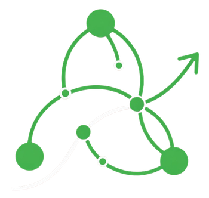
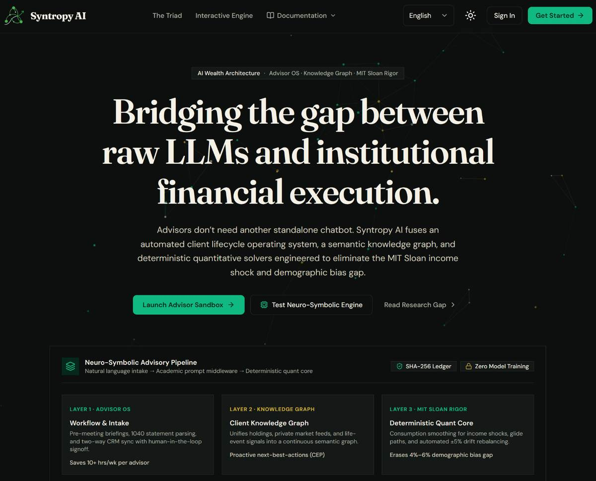
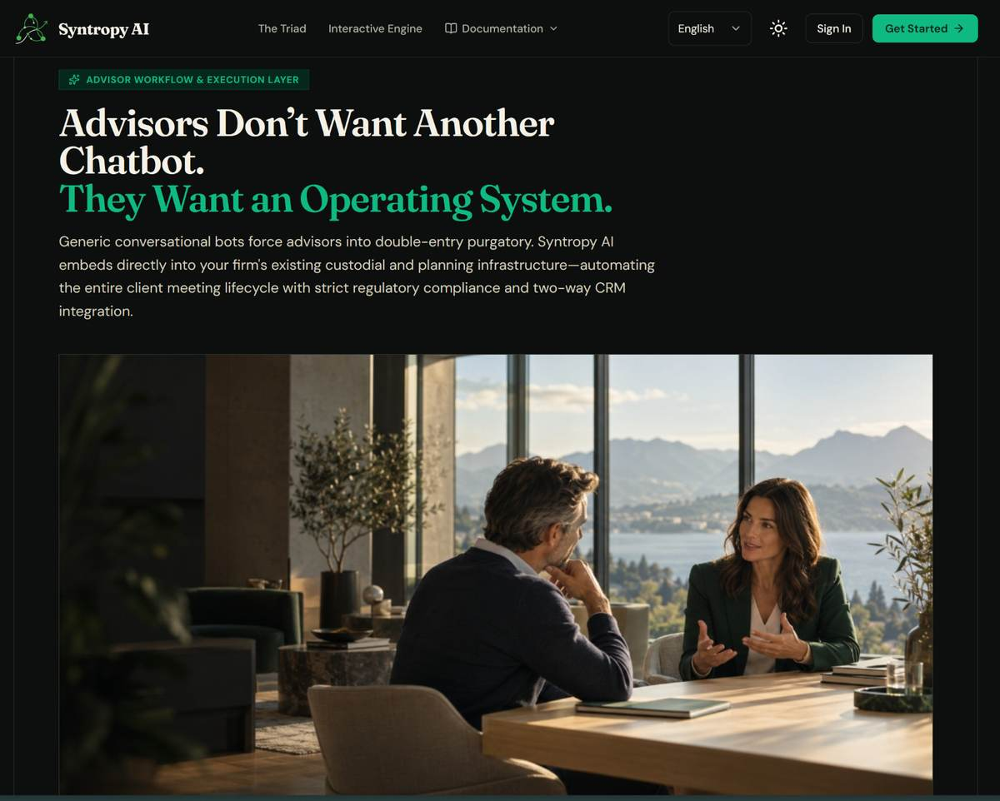
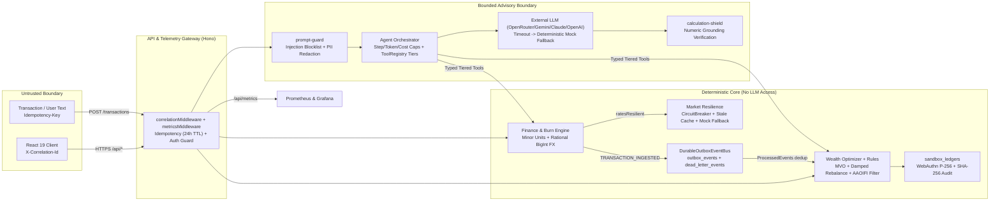

<p align="center">
  <a href="https://wealth-advisor-ai.vercel.app">
    
  </a>
</p>

<h1 align="center">DEWA — Dynamic Expat Wealth Agent (Syntropy AI)</h1>

<p align="center">
  <b>Models plan, translate, and narrate. Deterministic engines compute money and enforce compliance.</b>
</p>

<p align="center">
  <a href="https://github.com/Nikhil-Mundhra/Wealth-Advisor/actions/workflows/ci.yml"></a>
  
  
  
</p>

Originating as an International Track entry for the 2026 Shenzhen International FinTechathon, **DEWA** is a multi-currency cross-border wealth advisory system for expatriates. Every monetary balance, FX conversion, burn-rate runway calculation, constraint check, and audit digest is executed deterministically in TypeScript (`@wealth-advisor/rules` and backend domain services). Probabilistic LLMs sit strictly downstream of deterministic fact generation and validation.

<table>
<tr>
<td width="50%" valign="top"><p align="center"><sub>Advisor landing view and sandbox entry.</sub></p></td>
<td width="50%" valign="top"><p align="center"><sub>Multi-currency portfolio and compliance lifecycle.</sub></p></td>
</tr>
</table>

---

## Quick Start

Requires Node 24 (`nvm use` from `.nvmrc`) and npm 10+. Runs out of the box with `DATA_STORE=memory` (zero external database or API keys required).

```bash
# Install workspace packages (rules, contracts, backend, frontend)
make install

# Run API (:3000) + Vite web UI (:5173)
make dev

# Run full local guardrail pipeline (lints, typecheck, property/contract/SLA tests, evals, unit/integration tests, build)
make ci

# Run deterministic LLM eval suite and staged live load benchmark
make eval
make load-test

# Full containerized stack (MongoDB, backend, nginx edge, Prometheus, Grafana)
make up
```

---

## Architecture & Trust Boundaries

The central architectural rule is **neuro-symbolic separation**: no LLM output can introduce an unverified number, elevate capability permissions, or mutate sandbox custody.



### Core Architectural Decisions (ADRs)

| Boundary | Decision | Primary Trade-Off | Record |
|---|---|---|---|
| Computation vs. Narration | Pre-compute facts in `@wealth-advisor/rules`; verify every LLM output number in `shieldText` | Extra fact assembly maintenance vs. zero hallucinated arithmetic | [ADR-0001](docs/adr/0001-neuro-symbolic-boundary.md) |
| Async Event Processing | MongoDB `outbox_events` + `dead_letter_events` + `processed_events` (`DurableOutboxEventBus`) | Index write amplification per event vs. zero extra broker infra on Atlas M0 | [ADR-0002](docs/adr/0002-mongodb-transactional-outbox-queue.md) |
| Monetary Arithmetic | Integer minor units (`cents`) + exact `BigInt` rational scaling in FX cross-rates | Explicit currency pairing vs. eliminating IEEE-754 float drift | [ADR-0003](docs/adr/0003-mongodb-and-rational-minor-unit-money.md) |
| Agent Authorization | Code-enforced `ToolRegistry` capability tiers + WebAuthn ECDSA P-256 step-up + `sandbox_ledgers` | Passkey enrollment needed for Tier 3 vs. immune to prompt jailbreaks | [ADR-0004](docs/adr/0004-suggest-approve-webauthn-passkey-gate.md) |
| Hosting & Packaging | Live Vercel + Atlas M0 showcase paired with multi-stage Dockerfiles + Cloud Run (`min_instance_count=0`) TF | Cold starts at scale-to-zero vs. \$0 idle cost + portable containers | [ADR-0005](docs/adr/0005-hybrid-vercel-and-cloud-run-deployment.md) |

---

## Resiliency, Guardrails & Observability Summary

- **Financial Invariants & Damping (`rules/src/portfolio-optimizer.rule.ts`, `backend/src/core/http/idempotency.ts`):** MVO weights strictly sum to `1.0`, rebalance actions are self-financing (`SELL` before `BUY`), sub-`0.5%` drift trades are suppressed (`REBALANCE_DRIFT_THRESHOLD`) with damped steps (`0.75` factor) to prevent micro-churn, and state-changing HTTP routes honor 24-hour `Idempotency-Key` caching with `409 CORE_IDEMPOTENCY_CONFLICT` on mutated replays.
- **External Dependency Resilience (`backend/src/core/http-client/resilient-caller.ts`, `backend/src/modules/market/market.api.ts`):** Upstream FX calls run inside a `CircuitBreaker` (`CLOSED -> OPEN -> HALF_OPEN`), exponential backoff with full jitter, a 5-minute TTL cache, stale-cache serving, and deterministic mock fallback (`buildMockFxRates`) propagating `stale: true` and `staleReason` to cashflow consumers.
- **Async Eventing & DLQ (`backend/src/core/events/outbox-bus.ts`):** Transaction ingestion publishes `finance.transaction_ingested` into `outbox_events`; `wealth` subscribes idempotently via `processed_events` to recalibrate burn-rate runway and effective risk scores; consumers failing past `maxAttempts` move to `dead_letter_events`.
- **Bounded Agent Runtime (`backend/src/modules/advisory/domain/agent-orchestrator.ts`, `backend/src/modules/advisory/domain/prompt-guard.ts`):** Enforces `maxSteps` (`4`), token (`4096`) and micro-USD cost (`50000`) ceilings, per-tool/model timeouts, regex PII redaction + prompt-injection detection, and deterministic `MockLlmAdapter` fallback.
- **Observability Stack (`backend/src/core/telemetry/`, `infra/observability/`):** End-to-end `X-Correlation-Id` tracing (`frontend/src/lib/api-client.ts` -> `AsyncLocalStorage`), PII-redacted JSON logging, OTLP-formatted parent/child spans, Prometheus exposition on `GET /api/metrics` (`http_requests_total`, `http_errors_total`, `http_request_duration_ms`, `outbox_events_depth`, `dlq_events_total`, `llm_tokens_total`, `llm_cost_usd_micros_total`, `guardrail_triggers_total`), and a committed Grafana dashboard (`infra/observability/grafana/dashboards/dewa-overview.json`).

---

## Measured Verification & Load Test Results

All measurements below were executed directly on **`Apple M2 Pro` · `32 GiB RAM` · `Node v24.21.0`**:

### CI Guardrail Gates (`make ci`)

Full pipeline spec: [docs/architecture/testing-guardrails.md](docs/architecture/testing-guardrails.md).

| Gate Command | Scope & What Passed | Observed Result |
|---|---|---|
| `make docs-lint` & `make deps-lint` | Doc-to-code reachability, CLAUDE/AGENTS parity, acyclic module DAG | `72 files, 664 mapped paths`; `9 allowed edges` |
| `make infra-lint` | Non-root/healthcheck Dockerfiles, Terraform Free Tier HCL checks, secret scan | Passed (`0` issues) |
| `make typecheck` | Strict `tsc --noEmit` (`erasableSyntaxOnly`) across all 4 workspaces | Exit `0` |
| `make test-property` | L1.5 mathematical & regulatory invariants (`50+` random cases per rule) | `7/7 passed` (`162.7ms`) |
| `make test-contracts` | L2 error-code, validation-key, Zod enum, and Mongo index parity | `4/4 passed` (`15.1ms`) |
| `make test-sla` | 45-iteration statistical P99 budgets (`<25ms`..`<400ms` end-to-end HTTP) | `5/5 passed` (`1573.3ms`) |
| `make eval` | Versioned advisory eval suite `v1.0.0` (volatility, burn spike, Sharia, adversarial injection, model timeout) | `5/5 passed` in `63ms` |
| `make test` | Ephemeral `mongod` + in-memory unit/integration + React 19 UI suites | `605 passed` across `148 suites` (`31.2s`: 191 FE, 414 BE) |
| `make build` | Production Vite bundle + TypeScript verification | Built in `354ms` |

### Staged HTTP Concurrency & Breaking Point (`make load-test`)

Executed via `backend/src/scripts/load-test.ts` against a live local Node HTTP server (`DATA_STORE=memory`, mixed 25% `/api/health`, 25% `/api/finance/cashflow`, 25% `/api/wealth/optimize`, 25% `/api/advisory/chat`), targeting P99 `< 400ms` and `< 1%` error rate (k6 script matching this profile is in `infra/k6/load-test.js`):

| Concurrency | Requests | Errors | RPS | P50 (ms) | P95 (ms) | P99 (ms) | Max (ms) | SLA Status |
|---:|---:|---:|---:|---:|---:|---:|---:|---|
| 10 | 60 | 0 | 912.8 | 8.26 | 17.79 | 29.92 | 29.92 | OK |
| 50 | 300 | 0 | 975.3 | 12.05 | 198.19 | 253.64 | 259.07 | OK |
| **100** | **600** | **0** | **1099.8** | **10.83** | **315.45** | **421.16** | **453.02** | **BREACHED (`P99 >= 400ms`)** |
| 200 | 800 | 69 | 1371.1 | 20.07 | 334.50 | 432.40 | 448.70 | BREACHED |
| 350 | 1400 | 363 | 1635.7 | 113.62 | 541.03 | 618.84 | 640.20 | BREACHED |
| 500 | 2000 | 680 | 1769.3 | 107.12 | 740.39 | 882.93 | 947.20 | BREACHED |

**Observed Bottleneck:** Tail latency crosses `400ms` at **100 concurrent callers** (`421.16ms` P99) because `/api/wealth/optimize` and `/api/advisory/chat` run synchronous constrained MVO + 2,000-path Monte Carlo simulation directly on the single Node event loop, delaying concurrent requests in the same tick. Non-2xx responses starting at `200` concurrency reflect Hono route rate-limiting / request timeouts under CPU saturation.

---

## 3x Scale Bottleneck Analysis

At **3x steady production load (~300 concurrent users / ~3,000 req/s burst)**:

1. **Event-Loop CPU Starvation in MVO / Monte Carlo:** Offload `constructOptimalPortfolio` and `runStressTests` to a bounded `worker_threads` pool or Cloud Run worker service and cache snapshot-keyed proposals (`(asOf, riskTier, fxBucket)`).
2. **In-Memory Rate Limit & Cache Fragmentation:** Moving from one Node instance to multiple Cloud Run replicas (`max_instance_count > 1`) splits per-instance rate-limiters, circuit-breaker state, and FX caches; move shared rate-limiting and FX cache state to Redis/Upstash behind the existing cache/store ports.
3. **MongoDB Outbox Write Amplification:** Polling `outbox_events` and writing `processed_events` adds two extra document writes per transaction; beyond ~500 events/s, swap `OutboxStore` behind `EventBus` for NATS JetStream or GCP Pub/Sub ([ADR-0002](docs/adr/0002-mongodb-transactional-outbox-queue.md)).

---

## Threat Model & Security Controls

| Threat Vector | Mitigation in Code | Verification |
|---|---|---|
| Prompt injection via transaction/chat text | `sanitizeUntrustedInput` blocks override patterns and tag spoofing; `ToolRegistry` enforces capability tiers in code | `eval_04`, `backend/test/unit/advisory/eval-suite.test.ts` |
| PII or secret leakage to LLMs / logs | `redactPii` + `redactLogValue` strip emails, IBANs, 12-19 digit account numbers, phones, and Bearer/API keys before outbound calls/logs | `telemetry.test.ts`, `eval-suite.test.ts` |
| Unauthorized execution of capital moves | `POST /api/wealth/execute` requires registered WebAuthn ECDSA P-256 assertion + single-use server challenge + immutable SHA-256 `sandbox_ledgers` log | `stage-latency-sla.memory.test.ts`, `wealth-api.test.ts` |
| Duplicate webhooks / network retries | 24h `Idempotency-Key` middleware + `externalId` transaction deduplication + `processed_events` unique index | `idempotency.test.ts`, `failure-injection.memory.test.ts` |
| Security policy & headers | Strict CSP, `X-Frame-Options: DENY`, `nosniff`, CORS, `1MB` JSON body ceiling | `security-headers.test.ts`, [SECURITY.md](SECURITY.md) |

---

## Honest Limitations & Next Steps

- **Simulated Custody Only:** All accounts, portfolio executions, and `sandbox_ledgers` records operate against a simulated sandbox; live brokerage or payment execution would require regulated custodian APIs and multi-document ACID clearing.
- **Host Tool Availability During Local Build:** Neither `k6` nor `terraform` CLI binaries were installed on the development machine, so HTTP saturation testing ran through `backend/src/scripts/load-test.ts` (`infra/k6/load-test.js` holds the matching `k6` script) and `infra/terraform/*.tf` was checked statically via `scripts/infra-lint.mjs` (`terraform apply` was intentionally not executed to preserve \$0 cloud billing).
- **Dependency Advisories (`npm audit`):** `npm audit --omit=dev --audit-level=high` passes with zero high/critical vulnerabilities; two moderate upstream advisories exist in `hono` / `@hono/node-server` (`npm audit` reports `GHSA-qv5m-9pm6-hqp3`, `GHSA-4m76-xfj5-7975`, etc. affecting unused WebSocket upgrade / sub-app `mount()` helpers) and should be bumped in the next dependency maintenance pass.
- **Serverless Background Draining:** When deployed to Vercel Functions (`vercel.json`), `DurableOutboxEventBus` drains in-request (`autoDrain: true`) because Vercel does not host long-lived background workers; migrating the backend service to Cloud Run (`infra/terraform/main.tf`) enables an independent interval drainer and continuous Prometheus scraping.

---

## Disclaimer

Simulated sandbox environment only. Outputs are algorithmic demonstrations for engineering portfolio evaluation and do not constitute licensed financial, tax, or investment advice.
