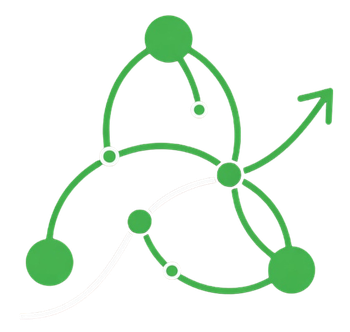
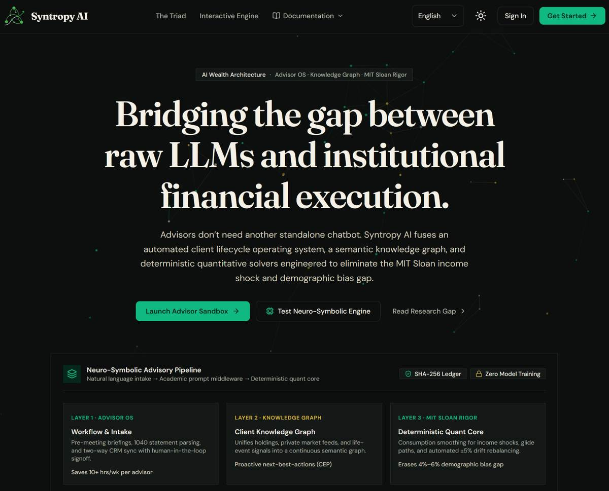
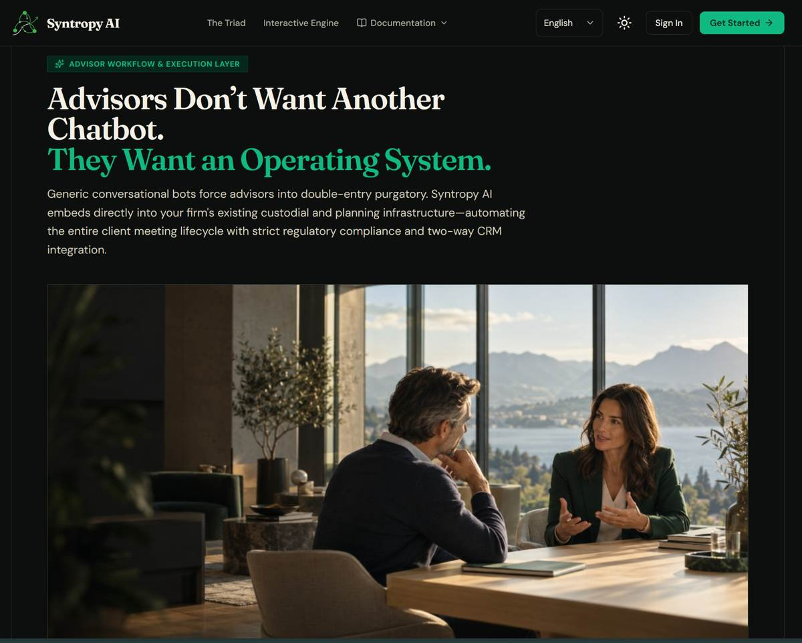
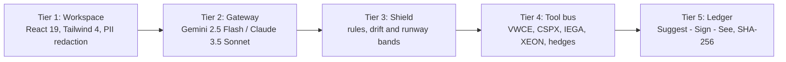
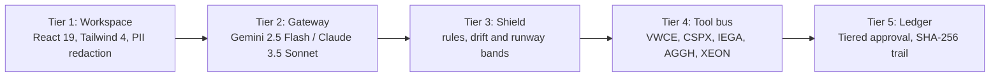

<p align="center">
  <a href="https://wealth-advisor-ai.vercel.app">
    
  </a>
</p>

<h1 align="center">Syntropy AI</h1>

<p align="center">
  <b>Wealth advisory agent for cross-border expats. Models narrate. Engines compute.</b>
</p>

<p align="center">
  <a href="https://github.com/Nikhil-Mundhra/Wealth-Advisor/actions/workflows/ci.yml"></a>
  
  
  
</p>

<p align="center">
  <a href="https://wealth-advisor-ai.vercel.app"><b>Live Demo</b></a> ·
  <a href="#quick-start">Quick Start</a> ·
  <a href="#executive-summary">Executive Summary</a> ·
  <a href="#value-proposition">Value Proposition</a> ·
  <a href="#topic-b-workflow">Topic B Workflow</a> ·
  <a href="#security-and-compliance">Security & Compliance</a>
</p>

<table>
<tr>
<td width="50%" valign="top"><p align="center"><sub>Landing page. Headline, pipeline, and sandbox entry.</sub></p></td>
<td width="50%" valign="top"><p align="center"><sub>Advisor workflow. Meeting lifecycle with compliance and CRM sync.</sub></p></td>
</tr>
</table>

## Quick Start

You need Node 22 or later and npm 10 or later.

```bash
# 1. Install workspace packages
make install

# 2. Start backend on :3000 and web on :5173
make dev
```

Open [http://localhost:5173](http://localhost:5173). The app starts in Advisor Sandbox with Demo Analyst (Elena Vance) selected.

Production build:

```bash
make build
make prod
```

## Tests

```bash
# All workspace tests
make test

# Frontend alone
npm test -w frontend

# Backend alone
npm test -w backend

# Checks
make typecheck
make deps-lint
make docs-lint
```

## Contents

- [Executive Summary](#executive-summary)
- [Value Proposition](#value-proposition)
- [Topic B Workflow](#topic-b-workflow)
- [Security and Compliance](#security-and-compliance)
- [Architecture](#architecture)
- [Disclaimer](#disclaimer)

## Executive Summary

Cross-border expatriates operate under severe financial fragmentation: multi-currency cashflows, erratic remittance commitments, differing tax jurisdictions, and fluctuating monthly burn rates.

Standard consumer LLMs fail catastrophically in this domain — empirical benchmarks reveal that standalone foundation models (e.g. OpenAI o3) achieve only **46.8% factual accuracy** in production finance, frequently hallucinating portfolio calculations, proposing catastrophic spending cuts, or exhibiting demographic framing bias (MIT Sloan, 2024).

## Value Proposition

**Syntropy AI** solves this through a **B2B2C Neuro-Symbolic Advisory Operating System**.

Licensed wealth advisors serve as the primary user, managing cross-border expat clients (with *Demo Analyst (Elena Vance)* as the lead family expat persona, alongside *Marcus Thorne*, *Aisha Al-Mansoor*, and *David Kim*).

The platform implements the core neuro-symbolic division of labor codified by modern financial multi-agent architectures (FinRobot V2, VERAFI SMT-lib, FinCom, and FAOS):

> *"Models formulate qualitative narratives, deterministic algorithms compute arithmetic, stateful graphs orchestrate workflows, and formal verification barriers enforce fiduciary compliance."*



## Topic B Workflow

| Feature | What it does |
|---|---|
| Seeded client book | Holds 4 accounts. Demo Analyst (Elena Vance) shows 3.2 month runway versus 6.0 month family floor and +18% US drift. Marcus Thorne holds 8.5 month runway with tax-loss harvesting. Aisha Al-Mansoor needs capital preservation and sukuk sleeves. David Kim shows +14% idle cash drag. |
| Pre-meeting brief | Builds a 30 second brief in one click. It shows headline, runway versus floor (3.0m individual, 6.0m family), drift flags, agenda, and trade proposals. |
| Product matrix | Compares 5 UCITS products with real TERs. VWCE 0.22%, CSPX 0.07% with 15% US tax edge, IEGA 0.09% AAA/AA, AGGH 0.10% FX hedged, XEON 0.10% euroSTR buffer. |
| Advisory chat | Answers through the calculation shield. Personal pillar checks cashflow and reserves. Cross-Border pillar checks corridors and FX shocks. Wealth pillar sets targets and enforces the 5% drift band. |
| Permission tiers | Tier 1 suggests and stays read-only. Tier 2 requires advisor sign-off to the ledger. Tier 3 gates client execution behind a passkey in sandbox. |

## Security and Compliance

### A. Technical Guardrails Implemented
- **Deterministic Calculation Shield:** Models never execute raw arithmetic. Every valuation, runway month, and drift delta is calculated by `@wealth-advisor/rules` prior to prompt assembly.
- **Immutable SHA-256 Audit Trail:** Every rebalance proposal and stress test simulation is hashed and recorded with a cryptographic digest (`/settings/ledger`), exportable to CSV.
- **Zero Training Guarantee:** API calls specify zero-retention parameters, ensuring client financial data is never ingested into LLM training corpora.
- **Privacy-Masked Client Sharing:** Shareable client strategy links redact absolute cash balances and account numbers (`/share/:token`), exposing only strategic asset percentages.

### B. Transparent Disclosure of Known Limitations & Scope
In accordance with the hackathon rules and integrity guidelines:
- **Passkey Hardware Execution (Tier 3):** The sandbox simulates biometric authorization with WebAuthn payload stubbing; production FIDO2 hardware token registration is scheduled for Phase 2.1.
- **Single-Tenant Sandbox Scope:** The current deployment operates under an isolated default tenant (`DEFAULT_TENANT_ID`). Multi-tenant database partitioning is enforced at the repository boundary but requires external IdP federation for live multi-firm rollouts.
- **Illustrative Market Scenarios:** The landing page simulator features illustrative benchmark stress tests grounded in MIT Sloan research. Live operations in the Advisor Workspace execute through the active calculation engine.

Full policy is in [SECURITY.md](SECURITY.md).

## Architecture



Details are in [docs/architecture/index.md](docs/architecture/index.md).

## Disclaimer

Sandbox mode only. Results are simulations. They are not investment advice.
