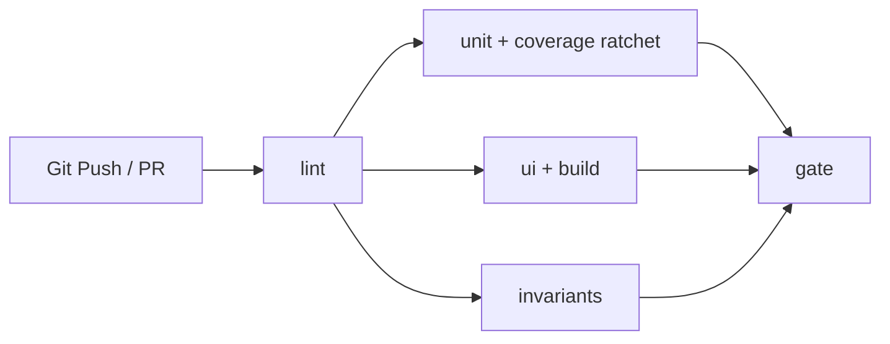

# Testing & CI/CD Guardrails Architecture

This document defines the neuro-symbolic Testing & Continuous Integration Guardrails for Syntropy AI (DEWA).

Because the platform orchestrates cross-border expat wealth advisory across Europe, the UAE, India, and East Asia under **SEBI & UCITS IV/V diversification caps**, **SCA & AAOIFI Sharia compliance**, **CFP Board / OECD household runway floors**, **Vanguard 5% rebalance corridors**, **FIDO2/WebAuthn Tier 3 biometric execution gates**, and a **Deterministic Calculation Shield**, standard CRUD testing is insufficient. Our guardrails are structured around two orthogonal engineering frameworks:

1. **The Granularity Framework (The Neuro-Symbolic Testing Pyramid)**: What we test at each layer of abstraction, from sub-millisecond unit checks and mathematical property fuzzing up to live cross-module HTTP orchestration and latency SLAs.
2. **The Execution Framework (Pipeline Topology & Cadence)**: How and when those checks execute locally (`make ci`) and in GitHub Actions (`.github/workflows/ci.yml`) to maximize developer velocity while guaranteeing zero arithmetic hallucinations and `<400ms` P99 latency.

---

## 1. The Granularity Framework (The 5-Layer Testing Pyramid)

In a modular TypeScript monorepo (`rules` + `contracts` + `backend` + `frontend`), we augment the classic Testing Pyramid with **Layer 1.5 (Property-Based & Formal Regulatory Fuzzing)** and **Layer 2/3 (Cross-Workspace Contract Parity & Stage Latency SLA Gates)**:

| Layer | Granularity Tier | Target Scope & Invariants Protected | Tooling & Entrypoint | Execution Budget |
| :--- | :--- | :--- | :--- | :--- |
| **L0** | **Static, Docs, Deps & Types** | Strict TypeScript (`tsc --noEmit`), zero `enum` / non-erasable syntax, acyclic backend module dependency DAG (`module-deps.mjs`), 100% mapped doc/source coverage (`docs-lint.mjs`), and production npm vulnerability scan. | `make docs-lint`, `make deps-lint`, `make typecheck`, `make audit` (`make lint`) | `< 10s` local |
| **L1** | **Isolated Unit & State Machine** | Deterministic bond valuation, DCF/WACC/DCF margin-of-safety, technical indicators, burn-rate runway, WebAuthn ECDSA P-256 ceremony, calculation shield, React 19 UI + native `<dialog>` accessibility. | `node --test` (`make test-unit`) and Vitest (`make test-ui`) | `< 5s` local |
| **L1.5** | **Property-Based & Formal Fuzzing** | **Mathematical & Fiduciary Invariants** over 260+ seeded randomized constraint tuples: (1) MVO weights sum to `1.0` inside sector/security bounds; (2) `shariaOnly: true` strictly enforces 100% AAOIFI-compliant assets; (3) `recalibrateRiskScore` obeys `[1.0, 10.0]` bounds, runway stress monotonicity, FX mismatch penalty, and `FAMILY_HOUSEHOLD <= INDIVIDUAL` safety floor; (4) Self-financing rebalance guarantees `BUY <= SELL` proceeds with `SELL` ordered before `BUY`; (5) Calculation shield blocks every invented number; (6) Rational currency conversions preserve exact identity & inverse tolerance. | Deterministic seeded PRNG (`backend/test/unit/rules/property-invariants.test.ts` via `make test-property`) | `< 0.5s` (260+ generated cases) |
| **L2** | **Cross-Workspace Contract Parity** | **Zero Schema Drift** across `rules`, `contracts`, `backend`, and `frontend`: verifies every module error code in `rules/src/error-codes.ts` maps to a registered HTTP error status in `ModuleRegistry`, every validation key in `rules/src/validation-keys.ts` is handled in `frontend/src/lib/validation/validation-messages.ts`, all Zod field contracts accept every rule enum value, and every MongoDB collection declares valid indexes or `$jsonSchema` validators. | Reflection & source parity test (`backend/test/unit/core/contract-parity.test.ts` via `make test-contracts`) | `< 3s` |
| **L3 & L4** | **Live Cross-Module E2E & `<400ms` P99 SLA Gate** | Full HTTP orchestration (`auth` signup/login + ECDSA P-256 WebAuthn passkey registration/step-up + `finance/cashflow` + `wealth/optimize` + `advisory/chat` + `sharing` create/read + fail-closed Tier 3 `/api/wealth/execute`) and 45-iteration statistical P99 stage latency gates. | `backend/test/integration/sla/stage-latency-sla.memory.test.ts` (`make test-sla` & `make test-e2e`) | `< 3s` |

---

## 2. The Execution Framework (Pipeline DAG & Fail-Fast Stages)

The Execution Framework governs **stage ordering**, **parallel fan-out**, **MongoDB binary caching**, and **merge gates** in `.github/workflows/ci.yml` and the root `Makefile`.

### Pipeline Execution DAG

`.github/workflows/ci.yml` runs one `lint` job, then three parallel jobs, then a `gate` job that needs all of them. Branch protection should require `gate`. Jobs share the pinned `ubuntu-24.04` runner, the npm cache and the mongod binary cache; a new run on the same ref cancels the older one.

| Job | Commands | Layers |
| :--- | :--- | :--- |
| `lint` | `docs-lint`, `deps-lint`, `infra-lint`, `typecheck`, `audit` | L0 |
| `unit` | `test-coverage` (backend tests plus coverage ratchet) | L1, L1.5, L2, L3 and integration |
| `ui` | `test-ui`, `build` | frontend L1 |
| `invariants` | `test-property`, `test-contracts`, `test-sla`, `eval` | L1.5, L2, L3, eval |
| `gate` | needs `unit`, `ui`, `invariants` | merge gate |



---

## 3. Enforced Latency & Coverage Ratchets

Every commit and pull request is gated against both **structural invariants** and **45-iteration P99 execution budgets**:

| Pipeline Stage / Component | Enforced SLA / Gate | Observed Baseline | Guardrail Test |
| :--- | :--- | :--- | :--- |
| **L0 Static, Docs & Dependency DAG** | `0` unmapped files, `0` illegal cross-module edges, `0` TS errors, `0` high CVEs | `66+` docs verified, `7` acyclic edges | `make lint` (`scripts/docs-lint.mjs`, `backend/scripts/module-deps.mjs`) |
| **L1.5 Property-Based Fiduciary Fuzzing** | `100%` pass across `260+` randomized MVO, Sharia, risk, rebalance, shield & FX tuples | `~0.34s` total runtime | `backend/test/unit/rules/property-invariants.test.ts` |
| **L2 Cross-Workspace Contract Parity** | `100%` parity across error catalog, validation keys, Zod enums & MongoDB schemas | `~2.7s` cold import + verify | `backend/test/unit/core/contract-parity.test.ts` |
| **Backend coverage ratchet** | lines `>= 93%`, branches `>= 83%`, functions `>= 84%` (raise as the baseline rises, never lower) | `94.77%` / `85.14%` / `86.48%` | `make test-coverage` (`test:coverage` in `backend/package.json`) |
| **Stage A · Cashflow & FX Burn-Rate** | `P99 < 25ms` across 45 iterations (`getCashflowSummary`) | `~3.2ms` total across 48 runs (`< 0.2ms` P99) | `backend/test/integration/sla/stage-latency-sla.memory.test.ts` |
| **Stage B · 365-Day Covariance Snapshot** | `P99 < 50ms` across 45 iterations (`measureSnapshot` over 260 aligned trading days) | `~12.5ms` total across 48 runs (`< 0.5ms` P99) | `backend/test/integration/sla/stage-latency-sla.memory.test.ts` |
| **Stage C · Constrained MVO & 2k Monte Carlo** | `P99 < 120ms` across 45 iterations (`constructPortfolio` with 2,000 simulated paths) | `~87.7ms` total across 48 runs (`~2ms` P99) | `backend/test/integration/sla/stage-latency-sla.memory.test.ts` |
| **Stage D · Calculation Shield & Copilot** | `P99 < 150ms` across 45 iterations (`advisory.chat` + proposal grounding) | `~89.1ms` total across 48 runs (`~2ms` P99) | `backend/test/integration/sla/stage-latency-sla.memory.test.ts` |
| **Stage E · Full HTTP E2E & Tier 3 Gate** | `P99 < 400ms` per full 5-endpoint advisory + share flow; fail-closed `WL_1004` passkey gate | `~902ms` total across 48 iterations + WebAuthn ceremony | `backend/test/integration/sla/stage-latency-sla.memory.test.ts` |

---

## 4. Developer Command Reference

```bash
make ci                 # Run the full pipeline locally (Lint -> Coverage -> Property/Contract/SLA/Eval -> Full Suite -> Build)
make lint               # Stage 1: Docs graph, module dependency DAG, strict TypeScript, and npm audit
make test               # Run all frontend Vitest and backend Node tests (with ephemeral mongod)
make test-coverage      # Backend tests with the coverage ratchet (CI `unit` job)
make test-unit          # Stage 2A: Isolated backend unit and deterministic financial engine tests
make test-property      # Run L1.5 seeded property-based mathematical and regulatory invariant fuzzing
make test-contracts     # Run L2 cross-workspace (rules <-> contracts <-> backend <-> frontend) schema parity checks
make test-sla           # Run L3 45-iteration P99 stage latency benchmark gates (<400ms SLA)
make test-ui            # Stage 2C: Frontend Vitest component, native <dialog>, and A11y tests
make test-e2e           # Stage 3: In-process cross-module HTTP E2E orchestration and <400ms P99 SLA gate
```
