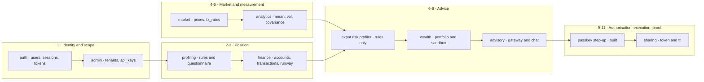
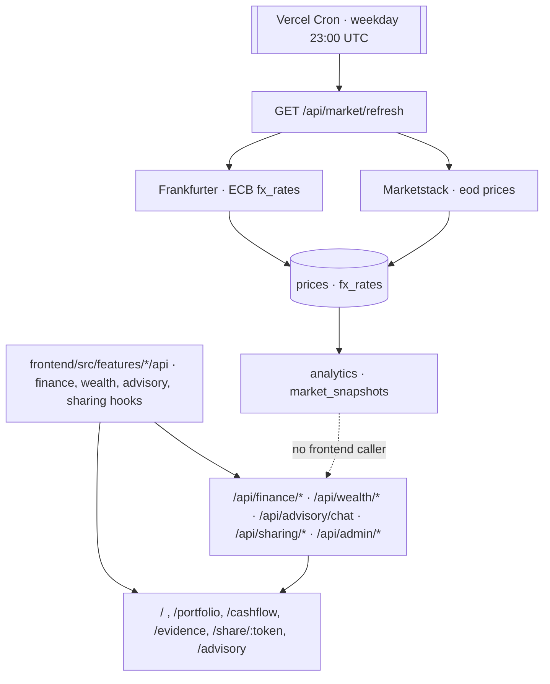

# Advisory pipeline

How one piece of advice is produced and proved: the stages, the engine behind each stage, the tier that authorises it, and what runs today.

Re-verified against `19f4b73`; the five modules added there changed most of this page. Sequence and ownership of the build: `docs/implementation-plan.md`. Missing capabilities and what blocks them: `docs/domain/advisory-gaps.md`.

Status vocabulary used here and in the gaps doc: `built` runs in the deployed backend · `partial` runs but is narrower than the stage, or unreachable from a product surface · `fixture` returns authored values instead of computed ones · `absent` no code owns it.

## Diagram

## Stages
| # | Stage | Input | Output | Owner | Status |
|---|---|---|---|---|---|
| 1 | Identity and tenant scope | email, password, API key | user, session, tenant-scoped query | `backend/src/modules/auth/`; `backend/src/modules/admin/infrastructure/db/schema/admin-collections.ts` | `partial` — the tenant travels in the token and every scoped route reads it from there (no header can move a caller), and `/admin/tenants` + `/admin/api-keys` provide provisioning UI; signup still joins the default tenant unless provisioned |
| 2 | Investor profiling | seven questionnaire answers | base risk score, stress band, ratios | `rules/src/profiling.rule.ts`, `contracts/src/profiling/profile-answers.contract.ts` | `built` — pure rules persisted via `GET` / `PUT /api/wealth/profile` (`risk_profiles`) |
| 3 | Financial position | accounts, transactions | balances, runway months and band | `backend/src/modules/finance/` | `partial` — accounts are valued into the base currency through the market FX spot rates and both endpoints agree, but an account no rate can value is left out of the reserves (reported as `unvaluedAccountCount`) and the monthly flow fallbacks are still literals |
| 4 | Market state | provider responses | `prices`, `fx_rates` | `backend/src/modules/market/` | `built` |
| 5 | Risk measurement | 365 days of closes | annualized mean, volatility, covariance | `backend/src/modules/analytics/` | `built` |
| 6 | Risk profiling | profile, runway, FX mismatch, volatilities | effective risk score | `rules/src/profiling.rule.ts`, `backend/src/modules/wealth/wealth.api.ts` | `built` — base risk score computed server-side on `saveProfile` and recalibrated dynamically with liquidity runway and FX mismatch |
| 7 | Portfolio construction | holdings, target weights | drift, actions, rationale | `backend/src/modules/wealth/wealth.api.ts`, `rules/src/portfolio-optimizer.rule.ts` | `built` — `constructPortfolio` performs MVO, Sharia screening, and jurisdiction allocation; `optimizePortfolio` derives drift-based self-financing actions and dynamic three-pillar rationale (`personalFinance`, `crossBorder`, `investmentStrategy`) |
| 8 | Recommendation and explanation | chat turn | reply, three-pillar rationale | `backend/src/modules/advisory/domain/llm-gateway.ts`, `backend/src/modules/advisory/domain/tool-registry.ts` | `built` — live Gemini/Claude/OpenAI/OpenRouter adapters with calculation shield, mock fallback, and 6-tool registry integration |
| 9 | Authorisation gate | step-up assertion | permitted or refused | `backend/src/modules/wealth/wealth.api.ts`, `backend/src/modules/auth/` | `built` — WebAuthn ECDSA P-256 verification and challenge binding gate `/api/wealth/execute` (`WL_1004` fail-closed on missing or invalid assertions) |
| 10 | Execution and evidence | permitted proposal, assertion | sandbox ledger row, audit digest | `backend/src/modules/wealth/wealth.api.ts` | `built` — verified passkey assertion unlocks atomic sandbox ledger append with SHA-256 digest before portfolio rebalance |
| 11 | Sharing | plan snapshot, token, mask flag | public read-only plan | `backend/src/modules/sharing/` | `built` — TTL and expiry enforced; the snapshot is the sharer's rebalance proposal; holdings and amounts are redacted when privacyMasked is true |

## Permission tiers and rules-based guardrails
Permission tiers are defined in `rules/src/permission-tier.rule.ts` (`TIER_0_READ`, `TIER_1_ADVISORY`, `TIER_2_SIMULATE`, `TIER_3_EXECUTE`).
The rules-based guardrail layer governs what operations and recommendations the platform and advisory agent are permitted to produce.

| Guardrail Rule | Target Tier | Enforcement Type | Mechanism | Configuration |
|---|---|---|---|---|
| `G_PASSKEY_TIER3` | `TIER_3_EXECUTE` | Hard Block | `backend/src/modules/wealth/wealth.api.ts` verifies WebAuthn signature via `PasskeyVerifier` port before ledger append (`WL_1003` / `WL_1004`) | Platform-Invariant |
| `G_CALC_SHIELD` | `TIER_1_ADVISORY`, `TIER_2_SIMULATE` | Hard Block (Fallback) | `backend/src/modules/advisory/domain/calculation-shield.ts` strips any response numbers not produced by deterministic engines, substituting deterministic fallback text | Platform-Invariant |
| `G_RUNWAY_FLOOR` | `TIER_1_ADVISORY`, `TIER_2_SIMULATE` | Hard Block on Risk Increase | `rules/src/burn-rate.rule.ts` checks runway; blocks risky equity allocation increases when runway is critical (<3m individual / <6m family) | Tenant-Configurable |
| `G_DRIFT_CORRIDOR` | `TIER_1_ADVISORY`, `TIER_2_SIMULATE` | Suppress Action | 5% corridor (`rules/src/asset-class.rule.ts`); prevents rebalancing turnover when drift is within tolerance | Tenant-Configurable |
| `G_SELF_FINANCING` | `TIER_2_SIMULATE`, `TIER_3_EXECUTE` | Hard Block | `planRebalance` in `backend/src/modules/wealth/wealth.api.ts` caps buy total at sell proceeds, ensuring self-financing execution | Platform-Invariant |
| `G_BOND_SOLVENCY` | `TIER_1_ADVISORY`, `TIER_2_SIMULATE` | Hard Block | `rules/src/fundamental-ratios.rule.ts` checks ICR >= 3.0x and Net Debt/EBITDA <= 3.5x; reallocates failing debt into sovereign bonds | Platform-Invariant |
| `G_VALUATION_TILT` | `TIER_1_ADVISORY`, `TIER_2_SIMULATE` | Warning / Tilt | `rules/src/fundamental-ratios.rule.ts` trims equity sleeve at 85th percentile of 5Y history and accumulates below 20th | Platform-Invariant |
| `G_FX_MISMATCH` | `TIER_1_ADVISORY`, `TIER_2_SIMULATE` | Warning / Hedge | `rules/src/fundamental-ratios.rule.ts` flags >30% foreign revenue mismatch against liability corridors to trigger FX hedge overlay | Platform-Invariant |
| `G_FCF_PAYOUT` | `TIER_1_ADVISORY`, `TIER_2_SIMULATE` | Hard Block | Filters out dividend yield traps exceeding 90% free cash flow payout ratio | Platform-Invariant |

## Deterministic engines
Every advice-bearing number is meant to come from a pure function over stored data; the model narrates, it does not compute. A live model's reply and rationale fields are kept only when every number in them matches a number the engines produced or the prompt carried (`backend/src/modules/advisory/domain/calculation-shield.ts`); any other field falls back to the deterministic text. Numbers spelled out in words are not detected.

| Engine | Computes | Status |
|---|---|---|
| `createRateTable`, `convertBatch` (`backend/src/modules/market/domain/`) | direct, inverted and EUR-crossed lookup; per-item conversion with round-half-even minor units | `built` — called across finance valuation and `get_currency_exposure` |
| `measureSnapshot` (`backend/src/modules/analytics/domain/`) | aligned log returns, annualized mean, volatility, covariance over a 365-day window | `built` |
| `runwayBand` (`rules/src/burn-rate.rule.ts`) | bands a months figure into `critical`, `warning`, `healthy` | `built` — computed by the finance module and served by `contracts/src/finance/cashflow.contract.ts` |
| Burn-rate calculator (`backend/src/modules/finance/domain/burn-rate-calculator.ts`) | inflow, outflow, liquid reserves and runway from transactions, scaled by household mode | `partial` — monthly flows are averaged over the calendar months present and reserves are valued into the base currency by `finance.api.ts`, but inflow and outflow still fall back to literals when a tenant has no transactions |
| `calculateBaseRiskScore`, `mapStressAnswerToRiskBand` (`rules/src/profiling.rule.ts`) | base 1–10 score and stress band from questionnaire answers | `built` — computed server-side in `WealthApi.saveProfile` |
| Portfolio optimizer (`rules/src/portfolio-optimizer.rule.ts`, `backend/src/modules/wealth/wealth.api.ts`) | MVO constrained target weights, Sharia zero-debt filtering, jurisdiction allocation, self-financing rebalance actions | `built` |

## Agent tools
All six domain tools are registered in `backend/src/modules/advisory/domain/tool-registry.ts` via `createToolRegistry`, enforcing permission tiers (`AV_1003` refusal on insufficient grant) and dispatching from `backend/src/modules/advisory/advisory.api.ts`.

| Tool | Engine it needs | Tier | Status |
|---|---|---|---|
| `get_cashflow_and_runway` | burn-rate calculator (`finance.getCashflow`) | `TIER_1_ADVISORY` | `built` |
| `get_currency_exposure` | `MarketApi.convertBatch` over portfolio accounts | `TIER_0_READ` | `built` |
| `calculate_adaptive_portfolio` | risk profiler & MVO portfolio constructor (`wealth.constructPortfolio`) | `TIER_1_ADVISORY` | `built` |
| `simulate_stress_test` | portfolio stress simulator & snapshot covariance (`wealth.constructPortfolio` + `analytics.latestSnapshot`) | `TIER_2_SIMULATE` | `built` |
| `create_rebalance_proposal` | self-financing rebalance planner (`wealth.optimizePortfolio`) | `TIER_2_SIMULATE` | `built` |
| `execute_sandbox_trade` | sandbox ledger with WebAuthn passkey step-up (`wealth.executeTrade`) | `TIER_3_EXECUTE` | `built` — fail-closed without verified P-256 assertion |

## Data flow today

`frontend/src/features/` has a hook per module (finance, wealth, advisory, sharing); every advisory page reads its backend route, with an empty state when the API has no rows.

Route surface: `contracts/docs/apis/market.md`, `contracts/docs/apis/analytics.md`, `contracts/docs/apis/core.md`. Module and event contracts: `backend/docs/module-dependencies.md`, `backend/docs/events.md`.