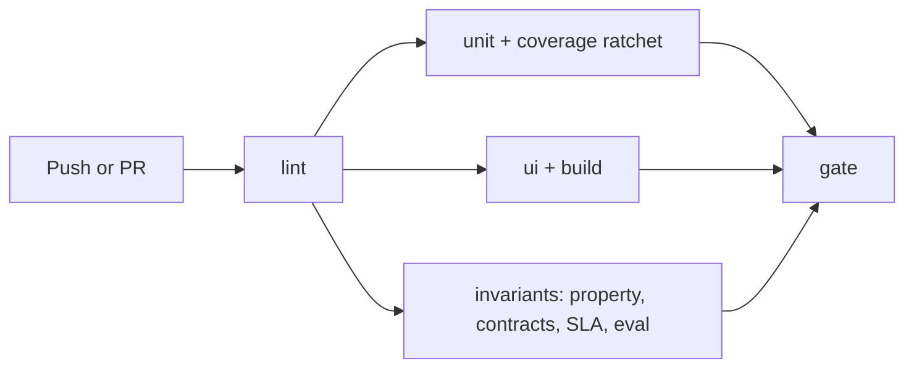

# Testing and CI/CD

Two frameworks: what each layer tests (granularity), and when each check runs (pipeline topology). Every check is a `make` target, so `make ci` locally matches GitHub Actions.

## 1. Granularity: the testing pyramid

| Layer | Scope and invariants protected | Target | Budget |
| :--- | :--- | :--- | :--- |
| L0 static | Strict TypeScript, docs link graph, module dependency DAG, infra and secret patterns, high-severity audit | `make lint` | under 30s |
| L1 unit | Deterministic financial engines, rules, repositories, React components | `make test-unit`, `make test-ui` | under 60s |
| L1.5 property | Randomized invariants over portfolio and rules math | `make test-property` | under 5s |
| L2 contracts | Schema, error catalogue and validation key parity across `rules`, `contracts`, `backend`, `frontend` | `make test-contracts` | under 1s |
| L3 SLA | 45-run P99 stage latency gate (400 ms end to end) on the in-process memory-store app | `make test-sla`, `make test-e2e` | under 10s |
| Eval | Versioned LLM guardrail and grounding suite | `make eval` | under 10s |

## 2. Execution: pipeline



Workflow: [.github/workflows/ci.yml](../.github/workflows/ci.yml). Jobs share a pinned `ubuntu-24.04` runner, the npm cache and the mongod binary cache. New runs on the same ref cancel older ones. Require the `gate` job in branch protection.

## 3. Ratchets

| Gate | Threshold | Baseline when set | Enforced by |
| :--- | :--- | :--- | :--- |
| Backend line coverage | 93% | 94.77% | `make test-coverage` |
| Backend branch coverage | 83% | 85.11% | `make test-coverage` |
| Backend function coverage | 84% | 86.48% | `make test-coverage` |
| End-to-end P99 latency | 400 ms | see test output | `make test-sla` |

Raise thresholds in `backend/package.json` (`test:coverage`) when the baseline rises; never lower them to pass.

## 4. Commands

```bash
make ci             # full pipeline locally
make lint           # L0
make test-unit      # backend unit
make test-coverage  # backend tests plus coverage ratchet
make test-ui        # frontend Vitest
make test-property  # L1.5
make test-contracts # L2
make test-sla       # L3
make test-e2e       # alias gate for the SLA stage
make eval           # LLM guardrail evals
```
